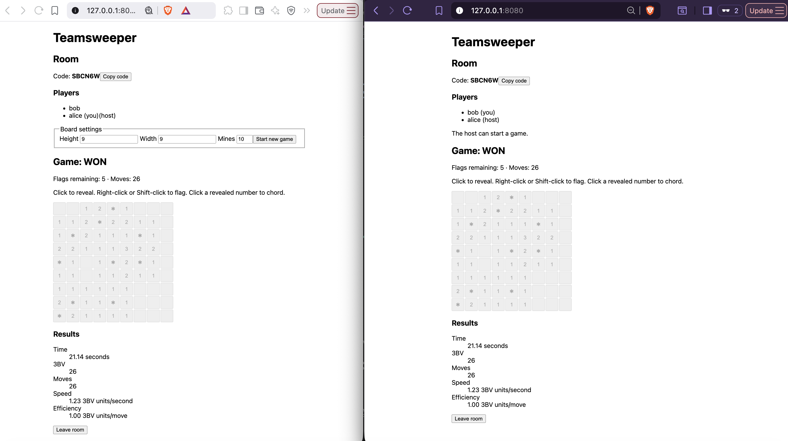
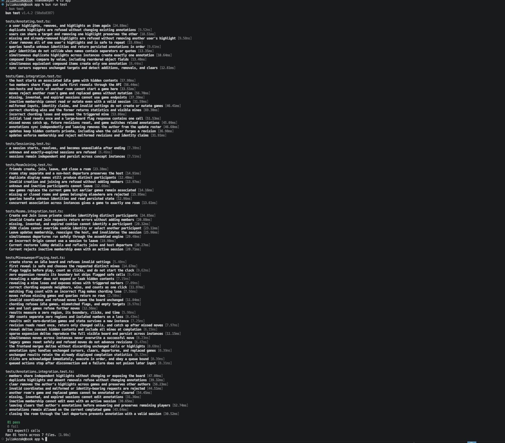

# Personal Project: Design Notebook

Welcome to my design notebook! Below are my realizations and design changes, listed per-assignment and in the order I considered and resolved them.

## P1: Design

**Breakpoint 1: Adding annotation.** After further considering the existing multiplayer Minesweeper apps, I decided that some "Annotating" functionality would be quite helpful and allow for easier collaboration, in support of my goal to make the game more cooperative. [Minesweeper Together](https://store.steampowered.com/app/3550060/Minesweeper_Together/) was a comparable app I considered in Exercise 1, and it allows users to draw on the board to communicate/solve together when they are stuck. I am a fan of the easy-to-use annotations offered on [Chess.com](https://www.chess.com/) which allow you to highlight squares and draw paths, so I think incorporating a similar highlighting feature would be a good choice. In terms of concept design, I also think this is separate from game functionality, rooming, etc. as I introducted in my Exercise, so it could be organized into its own general concept `Annotating [User, Item]`. I still need to decide how the user would place down annotations, since both left-click and right-click already have standard functionality for game-playing.

**Breakpoint 2: Splitting into concepts.** After deciding key features, I got a bit stuck on trying to split functionalities into individual modular concepts. 

I decided `RoomJoining [User, Game]` could definitely be its own concept, as the functionality for creating, joining, and closing a room was orthogonal to playing a game, and creating/starting the game can be triggered via reactions.

Then, I considered how to encode gameplay into concepts. I decided one large `MinesweeperPlaying` concept was the best way to group game creation, cell reveals, cell flags, game state, and time/statistics; this is because all such actions will depend on one shared board state, and splitting into different concepts would create complex dependencies. I was partially considering against this design decision because it would require one lengthy concept, but since the Minesweeper game/moves are largely self-contained and not subject to change, it would make sense to encode them together in this way.

Beyond gameplay functionality, storing/ranking statistics is a separate functionality I want to incorporate, since it is a useful performance indicator on [Minesweeper.online](https://minesweeper.online/). Storing and ranking games requires no specific structure on the game or its associated fields, so I think `PerformanceRanking [Item, Metric]` would be sufficient, i.e. each Item is tied to a list of Metrics it can be filtered/ranked by.

Lastly, I considered incorporating Annotation as a concept, and I wanted to stick with my initial generic `Annotating [User, Item]` idea which can associate an item to an annotation made by a user, or remove/manage such annotations. 

**Breakpoint 3: Type parameters revision.** I decided `PerformanceRanking [Item, Metric]` wasn't generic enough for the purpose of ranking, because I also want players to be able to filter by room, board type, and possibly any other additional properties. So, I am expanding to `PerformanceRanking [Item, Scope, Category, Metric]`, where `Scope` will be a coarse filter applied (ex. filtering by room), which can be subdivided by `Category` (ex. board size). Each `Metric` will still maintain its same functionality, where we can view/rank by its value.

I also decided `RoomJoining [User, Game]` only needs to be `RoomJoining [Game]`, because part of my goal is to make games easily shareable without a player needing to have an established user identity. Instead, Rooms will just have sets of Participants each with their own display name.

**Breakpoint 4: 3BV in Minesweeper state.** I decided against including board-derived metrics like 3BV in the `MinesweeperPlaying` state, because although they are properties of the board, they are not essential to the "playing" functionality and instead pertain more to `PerformanceRanking`. I chose to expose a `_getResult` query action which can compute and return all performance metrics based on the stored state of the game, which a reaction can retrieve all at once and feed into `PerformanceRanking`. I think this cleanly isolates the functionality of generating statistics from the functionality of playing.

**Breakpoint 5: Create vs. reveal actions.** I was debating where exactly the action of "starting" a game should go, because there are a couple steps required to begin playing. I was first considering making the `create` action place mines and start the timer, and subsequent `reveal`s proceed on a created board. But, typically Minesweeper boards place mines on cells distinct from your first click location (to ensure you don't instantly lose), and the timer starts at your first click. Instead, I made the `reveal` action also place mines and start the timer on the first click, and the `create` action just initializes the Game object. This also creates a good separation for the lobby + game UI's, since `create` can move players to the game screen, and the game will only actually start at the first `reveal`.

**Breakpoint 6: Room closing and hosting.** While thinking through my `RoomJoining` concept, I was considering how whole-group actions like starting the game should occur, which I figured would be handled by a host (person who creates the room). But it is also possible for the host to leave, so I chose to add arbitrary host reassignment for when this happens. I'm not sure whether this is the best option right now (perhaps a new player doesn't want to host), but I think it would be easy to modify within the `RoomJoining` concept if I want to change this logic later. I also decided that a room would close automatically when everyone leaves, which makes sense as there is no longer a host or any active participants.

**Breakpoint 7: UI design choices.** When working on the UI sketches, I was unsure where exactly to place each game-related functionality, since I also needed to incorporate annotation, and actions for game restart. I think a UI that has as few additional/unfamiliar buttons as possible is preferred, so I chose to integrate both of these just into the Minesweeper board itself. A center-click would add annotations, and the host would be able to click the top bar of the board to start a new game (also a function in popular Minesweeper sites). I was alternatively considering having a "toggle annotation mode" button at the side of the board, but I think this would be inconvenient for players who just want to quickly reference a part of the board.

## P2: MVP

### Initial Implementation Plan

My overall plan for implementation has the following steps:
1. Write the design for MVP concepts (`MinesweeperPlaying`, `RoomJoining`, `Annotating`). I will follow the sync-engine tutorial to draft the markdown for these concepts, their types, and their compositions, heavily basing the documentation on my P1 work (I'll include all actions from there initially), and check the design as I write. These will give me sufficiently detailed specifications to implement, test, and iterate on.
2. Implement `RoomJoining`. I will start with the backend TypeScript and MongoDB operations (updating the design markdown accordingly as I iterate), and I will test the actions/API I write before moving onto the frontend. From there, I will create a very basic lobby UI using Vue (unstyled inputs/buttons to create/copy/join rooms).
3. Implement `MinesweeperPlaying`. I will similarly start by implementing the backend logic, which includes all legal game moves, and determining win/loss (I'll hold off implementing `_getResult` til later, when I focus on storing statistics). I'll connect room operations to game creation by registering new sync-engine compositions, and test the actions, API functions, and integration. Then I'll draft the frontend, which will have a `Board.vue` child to render the board and accept user input requests. I'll first test the game in full as a single player, then I'll open two sessions to test the synchronized play and automatic state update for multiplayer.
4. Implement `Annotating`. I'll implement the backend of `Annotating`, test its functionality, and rebuild its requests through sync-engine. I'll then add the frontend component of rendering highlighted cells selected by each player. I'll test this out in a multiplayer gamemode by similarly opening two sessions.
5. Implement `PerformanceRanking`. I'll first complete and re-register `MinesweeperPlaying` with the query `_getResult`, then complete and connect the `PerformanceRanking` backend to store results. After testing the statistics and ranking on various games, I'll implement the skeleton UI I initially drafted, which sorts and shows results in the game sidebar.
6. Finalize frontend. One goal of my app was to maintain a familiar Minesweeper UI, which I will leave as a last step once I've verified all functionality. Here, I'll restyle and reorganize the UI to be as simple and user-friendly as possible, and iterate on any data display choices.

My target for P2 is to get as far as step 4, and start on step 5 by implementing end-of-game statistics. I will continue with this plan if I have time remaining, and leave the remaining work for P3.

**Breakpoint 1: context + step 1 revision.** As an added "step 0" to my plan above, I went through sync-engine documentation to understand what was expected in my design markdown docs, as it was slightly different to what I initially wrote in P1. For example, I spotted that type parameters needed to be declared differently, in a "types" section and as external types. I additionally saw the examples had `refuses` error codes, so I translated my action preconditions into more precise cases like the `Reserving` example. I also made state-reading queries implicit in my P1 (i.e. ones that were just pulling some state field), but here I wrote explicit definitions for getters so that reactions would be able to access these parts of state. With the help of an LLM to parse documentation, I saw that sync-engine specified `Rule:` lines for invariants (helpful documentation for implementation), which I drafted as well as I believe it would strengthen my design and catch bugs while I test.

Since my work just for the `RoomJoining` concept was quite extensive, I decided to focus on getting the full backend pipeline working for just this one concept before moving onto the others, which would also require markdown redrafting. I think it is easier for me to extend an existing backend framework rather than build entirely new components one-at-a-time, so starting with only one concept specification that is implemented and tested would make it easier to draw inspiration from existing code/documentation, and extend to the other concepts later.

**Breakpoint 2: `RoomJoining` TS implementation discoveries.** While implementing, I noticed that there was a hole for race conditions in my initial plan of host assignment/room leaving, because if actions could interleave, then it would be possible for (1) Host A to begin a `leave` action and select Participant B as the next future host, (2) Participant B to leave, then (3) the `leave` action assign B to be the new host. But returning to the sync-engine documentation, I saw that actions were serialized per concept instance, so I wouldn't have to worry about this.

I used an LLM to draft my TypeScript implementation and I manually verified logic function-by-function. Overall I found the markdown files to be incredibly helpful in drafting and verification because the structure of my TS file was ultimately very similar to the markdown.

There were a couple helper methods I needed to implement which were not initially in my concept design plan, which are `#makeCode` and `#ensureIndexes`. For simplicity in P1 I skipped the details of "generating a random unique code", which I now needed to implement an algorithm for. I decided a 6-character code, each character from a 32-letter alphabet, would be a strong choice as it would offer ~10^9 total possibilities i.e. low probability of collision. I believe a 6-letter code is also used by 6.1040's class join page, and I think it is a readable and user-friendly approach to code generation. Additionally, I followed the sync-engine tutorial's example of enforcing uniqueness invariants (as was done in `reserve`), as I needed a similar property to enforce that codes and assigned games were never duplicated, hence I added the `#ensureIndexes` setup helper.

When testing, I found it helpful to reuse aspects from the mongo-practice tutorial. I decided to organize tests into a separate directory, reuse test-db logic, and structure my asserts similar to the example ones there. The `test-api` script from the prep assignment was also helpful, and I am planning to write similar assertion-based scripts to test the API/integration later down the line. I found it helpful to draft a list of concrete cases/features I wanted to test behavior for, namely one standard round of entering/exiting a room, host reassignment, inactivity handling, and bad request handling. I planned 9 tests for my concept code and found it helpful to have an LLM draft the implementation for them.

**Breakpoint 3: Sessioning addition.** While expanding my `RoomJoining` implementation, I realized that I abstracted away the mechanism which is assigning a user to a participant ID for the duration of their play. I was considering integrating this concept into `RoomJoining` since we could potentially store a session ID or another trustworthy identifier within this concept's state, but I think this solution is not so modular as we may potentially want other auth mechanisms in the future. So, I decided to add a `Sessioning` concept which was entirely independent of room membership, and would allow endpoints to identify the requester. This required adding one new simple concept to my documentation, which I then implemented in the same order of steps as I did for `RoomJoining`. When implementing, I decided to keep cookie handling in `http.ts` rather than in `Sessioning`, because session identity was independent of how the token was transported. In my integration testing, I included the `Set-Cookie` and transport steps to make sure the full combined behavior was as intended.

At this point I had two drafted concepts, so I first chose to test the Sessioning concept code via three checks (the concept itself was quite simple). Then, I chose to draft integration tests, where I included both session and cookie handling as part of how room membership was handled. I thought it would be most important to check that issued sessions identified the right participants, and that expired sessions could not authorize requests.

**Breakpoint 4: Frontend setup.** I followed the sync-engine tutorial for setting up the frontend, but since I want my app to use Vue, I needed to adapt the instructions to use Vue + Vite as was recommended. I created a similar `web/` subdir, and with LLM help I drafted a basic `App.vue` and `main.ts`, and I set the `PUBLIC_ORIGIN` environment variable according to my configured frontend. I had some trouble running `bun run check` with the new `web/` directory (it seemed like `tsc` wasn't recognizing the .vue and CSS imports), and I asked the LLM for help to resolve this. It explained that tsc does not understand .vue and CSS imports by default, so I added declarations in `env.d.ts` to let it recognize them. In the end, I could run the page via `bun run dev`, and I could manually verify that everything was working (page rendering + Vue interactions) by navigating to the frontend URL.

**Breakpoint 5: Frontend functionality testing.** The first part of the frontend that I implemented was the `RoomJoining`/`Sessioning` UI, where I added basic controls for creating/joining/leaving rooms, along with copying the room code and displaying request errors. I also needed to adapt the tutorial's `app.ts` example into Vue, which my LLM helped me with. I also chose to skip styling, so as to focus on functionality first.

I tested the lobby UI manually through `bun run dev` and navigating to the frontend URL. I tested creating/leaving lobbies (checking that reloading restored my session and the UI required me to leave before joining another lobby), and tested joining via code (specifically that you could join an existing/active lobby, not inactive ones, and not nonexisting ones). I also tested opening multiple sessions via private windows, so I could check that a user could join someone else's lobby. All my tests were successful, and gave the expected behavior.

**Breakpoint 6: Extending frontend data display, polling, and views.** In my basic frontend with lobby UI functionality, there was little to no data actually displayed in the lobby, whereas my initial plan was to include a list of the joined players. I decided to implement this with a 2-second polling mechanism because I wanted updates to occur without refresh (and I could change the frequency of polling later). This polling only occurs when the user is in a lobby (polling takes place on a particular Vue component).

I also realized I had incomplete understanding of the term `view`, where I wasn't yet defining views in my documentation/backend. I learned that the `view` could define a larger backend lookup, so I defined one for `ActiveLobby` properties which could be reused in the endpoints.

With the extended view, I added new integration tests to check the lobby response after various joins/leaves. Through testing, I spotted and corrected some errors in my LLM's draft of a `Rooms.ts` endpoint (there was one missing response step), and I corrected it.

**Breakpoint 7: MinesweeperPlaying implementation + error codes.** While rewriting the documentation for the `MinesweeperPlaying` concept, I realized that there could be a lot of different error cases that would be split across individual actions (ex. "MOVE_NOT_ALLOWED" within a chord move, flag move, reveal, ...), and I wanted to be able to group the error codes for a simpler design. I reviewed the sync-engine documentation and saw that error codes could be shared across actions, so I rewrote my `refuses` lines to account for this. Rather than having ~15 separate error codes, I was able to reduce to three main ones. With LLM assistance, I thoroughly tested each of these broader error cases after implementing the concept functions.

I will also return to my `Sessioning` and `RoomJoining` concepts to see if I can better group error cases like this, in case it might clean up my design/implementation.

**Breakpoint 8: Plan revision.** I initially said that I would implement `_getResult` as a later part alongside `PerformanceRanking`, but I decided that implementing and displaying the results now would be easier because I was already working on the Minesweeper concept function implementations. Since the Minesweeper moves/actions were at the top of my mind, it would be easier to complete now, then just focus on wiring this data and ranking the results when I implement `PerformanceRanking`.

**Breakpoint 9: Integrating MinesweeperPlaying.** Integrating the new concept was a somewhat new experience as I needed to consider what features were already in place and how I would organize testing the new reactions. I decided that organizing my integration test files incrementally made sense, as I already knew that the `Rooms` integration tests were passing, so I could organize all my `Game`-related tests in a new file to check the added Game integration functions. After drafting those and getting them to pass, I was confident the backend was functioning as intended, so I could move onto implementing/manually verifying the Minesweeper UI. My tests checked host-only game creation, shared moves across different participants, rejection of unauthorized requests, and win/loss statistics.

**Breakpoint 10: UI Testing.** At this point in testing the UI, I realized it would be helpful to list details on the page that I wouldn't necessarily display in the final product. While drafting the Game UI, I found it helpful to list the raw game status on the page, so I could ensure that the display made sense given the status. I tested the game by opening two sessions (one host, one additional participant) and checking that synchronized moves would register/update on both screens, and the host had additional settings/restart controls. I tested for win, loss, restart, and mid-game leave/joins, and refreshed the pages at various points to check that the lobby state was being restored/rendered. Below is a screenshot from my (unstyled) successful UI testing!

  

**Breakpoint 11: UI refactoring.** My `App.vue` code was getting a bit lengthy at this point, so I decided it would be a good idea to do a minor refactor/restyle just to get the overall visual structure I initially planned. My P1 UI sketches included a "sidebar" mainly for information, and a main panel for actions. The main components I could identify right now were the sidebar, lobby view, gameplay view, settings panel, and the game board itself, so I decided to group vue code according to this (`components/Sidebar.vue`, etc.). As I continue to build UI features, I think this will make it easier to identify the added features and reason where their rendering should belong. After this refactor, I checked for the same behavior as I tested when building my UI in the last breakpoint. 

**Breakpoint 12: Integration test refactoring.** I noticed one poor design choice of my existing integration testing, which was that I called `assemble` separately within each file; this would require me to update every single instance map every time I made an addition. As a small refactor, I thought it would be better to create a separate `test-app.ts` file similar to `test-db.ts`, and this would allow me to resuse both the app assembly and api instantiation logic which would be shared across all future integration tests. After my refactor, I reran tests to make sure all were still passing.

**Breakpoint 13: Composite type in `Annotating`.** When writing P1, I specified that the the `Annotating` `Item` generic type would be instantiated to `(MinesweeperPlaying.Game, MinesweeperPlaying.Coordinate)`, which was sort of informal. When implementing this with sync-engine, I thought to create a concrete type `GameCell` which would aggregate this info in order to instantiate the `Annotating` concept. I first thought to encode a list/tuple as a string and pass that as the Item type, but I thought this approach wasn't very ready-for-change, so instead (after reviewing documentation with LLM help) switched to an object-like type which sync-engine would support. I slightly modified by initial concept design by adding the `GameCell` type into `types.md`, and tested this when implementing/integrated annotating. Using an object also had the advantage of not requiring a specific key order of [game, row, column] which makes it more ready-for-change, so I added a regression test ensuring field reordering was supported.

**Breakpoint 14: Plan deviation with annotation UI.** While implementing the annotation UI, I had many ideas for how I would actually render cell highlights, and I decided to spend more time on this UI-specific detail right now rather than saving it for later. I wanted a couple key features for highlighting, which were that (1) each player had their own highlight "color" (stateless, i.e. only deterministically derived from the lobby state), (2) colors assigned to different players were visually different up to some number of players, and (3) colors would be somewhat different for each lobby you joined (to make things interesting). To implement this, I added `colors.ts` which would control color-related selection and operations: colors are picked from a constant RGB palette, randomly but seeded based on the room ID, and assigned in participant ID order. This would ensure colors were consistent across reloads and across different user views. Since multiple users could highlight one cell at the same time, I used CSS `color-mix()` in order to combine the corresponding colors in a visually pleasing way, but still maintain the alpha value so you could see the contents of the cell. I stuck with my initial plan of making center-click create highlights, where a user can either click or drag. One tradeoff of this being stateless is that colors may reshuffle when players join or leave, but I think I am ok with this feature as trying to maintain consistent colors across joins/leaves may also be messy. I tested the highlight, unhighlight, clear, mixing, and color assigning functionalities manually by opening various sessions and lobbies.

**Breakpoint 15: Server latency.** At this point I had a working MVP, so I decided to work on a small improvement that would make the user experience a bit smoother. When implementing annotation, I added that a mouse release or click would trigger a backend action, and then you would see the updated board with highlights shortly after the request was processed. I didn't like that this left a couple ms where you would see the old board state before your highlight move, so I decided it would be ok for a user's view to temporarily diverge from the server view while their flag or highlight request was being processed. After the user's request is submitted, the frontend now stops polling until it is processed and maintains its local view, and afterwards, the UI will continue live-updating with server state.

I initially drafted the new functionality in `App.vue` which was getting lengthy again, so I decided to organize this logic into `controller.ts` for readability. I tested manually by opening two sessions and making moves/highlighting, and I was happy with the smoother result.

**Breakpoint 16: Revising test setup.** While finally reviewing the rubric, I realized my integration tests were a bit poorly defined as they directly inserted into MongoDB rather than establishing state through concept actions. I rewrote these with concept actions, though realized the randomness in mine placement would cause predictability issues, so with LLM help I controlled just that one mine placement function. After this refactor, my integration tests were no longer directly writing actual game or room state, and everything ran successfully.

**Breakpoint 17: Refactoring with board updates.** I had a frustrating late-stage realization that I never tested with extremely large boards, and I started to feel that even 30x30 boards were too slow/unresponsive to play enjoyably. My backend design was a bit flawed in that I passed the full-board snapshot on every poll result, which was too frequent + large and overwhelming the backend when the board had greater width/height.

Once I realized this, I spent most of my time thinking of a minimal but clean addition to my backend markdown designs that would be able to improve upon this latency. Most of the added work was just writing new queries, endpoints for them, and integrating that into the frontend, and I reasoned that this could be done with minimal state addition. I primarily wanted to improve latency in two ways, which were (1) allowing a user to make moves without requiring a server response between every single one, and (2) only forwarding "updates" to the client which listed changed cells rather than a full board snapshot. The only state modification I made was adding `cellRevisions` to `MinesweeperPlaying`, which records the revision of each cell’s most recent visible change. This would allow the server to return only the cells updated since a client’s last received revision.

One other idea I considered was sending moves for clients to reproduce locally, but clients cannot calculate reveal outcomes without knowing hidden mine positions. I kept those calculations and move validation on the server, sending changed visible values instead. 

Alongside `MinesweeperPlaying` changes, I added the `_sync` query to `Annotating`, which allows the backend to only return an author's annotations when their content marker changes, also reducing message volume. The `Game.Updates` reaction combines new annotations and board changes, and the frontend can cache the board + merge in these updates when it polls for changes.

Testing was very important for me here as I felt the changes were quite involved, so I added regression tests for the added components of `MinesweeperPlaying` and `Annotating`, as well as integration tests covering initial resets, repeated reads, single-cell updates, game replacement, annotation clearing, completion announcement, and conflicting writes. I was also able to verify quick updates and response when manually testing the UI.

At this point all my tests were passing, and I added ~15 more as regression:

  

### Remaining work for P3

Here is a list of my remaining tasks for P3, in order of priority:

1. **Performance Ranking.** I still need to complete my last proposed concept `PerformanceRanking`, which will include a new reaction for storing the `MinesweeperPlaying` `_getResult` statistics, the functionality to store and rank them, and displaying them in the UI.
2. **Minesweeper Board UI.** In my design plan I prioritized making a familiar Minesweeper UI which I do not yet have, so I will implement this with higher priority.
3. **Otherwise improved UI.** Outside of the board itself, my current UI is also quite unstyled, so I will think through what details I would like to reorganize or potentially omit from what is currently shown.
4. **Session lifecycle.** Currently I do not remove a player from a room when they close the tab, which I am reconsidering as a design decision (it is good if they accidentally close the tab, but bad if they think closing the tab should remove them). Perhaps I will alter this logic in P3.
5. **Deployment.** I'll get into deploying the app publicly as part of P3, and I'll go through similar manual verification procedures as I followed while testing.

## P3: Beta

**Breakpoint 1: Implementing PerformanceRanking.** I left my last concept `PerformanceRanking` for P3, and I decided to match my previous approach of (1) implementing/testing the concept, (2) integrating/testing, and (3) adding the concept into the frontend. My implementation essentially matched my design from P1 which made it easy to write documentation/test, and the only feature I initially thought to add was selecting particular indices in the ranking (I wanted pagination in my frontend). Reactions were similarly very close to my P1 design, and I just hit one intermediate error with specifying instance type parameters (I tried `String` in place of `RankingMetric`) which I could resolve from reading sync-engine docs. When implementing the frontend, I returned to my UI sketches from P1 to realize I forgot I wanted to store losses alongside wins, so I needed to iterate on my concept design slightly to add that in. My initial UI is minimal, and it allows for filtering by category, ranking by every stored metric, and viewing/retrieving results in pages. I tested the backend and integration as I went, then manually verified the UI by playing/ranking >10 games and checking all filter, rank, and page interactions made sense.

**Breakpoint 2: Board UI.** My next goal was to create a board UI that is very similar to what most Minesweeper players are familiar with, i.e. the one featured on minesweeper.online. I decided to refer directly to their site for board styling where I inspected an Expert-size board's HTML. Browser DevTools were very useful here as I was able to directly view the HTML and embedded SVGs, and I used the browser console to inspect the styling of key elements (specifically cell dimensions, and the margins between elements on the board). A lot of board elements were actually SVGs, which I was able to download and embed some subset of them in my own UI. One thing I noted was that I'm not entirely sure how ok it would be to reuse their exact elements on a deployed/commercial project (specifically number/flag/mine/cell SVGs, since downloading a number of them was quite web-scrapey), but I reasoned it would be ok for the sake of my project where one of my primary goals was to create familiar UI. I plan to credit their site for these board assets, and the remainder of my UI will otherwise be very different to their website.

**Breakpoint 3: Full page UI/styling.** I anticipated styling to be an ultimately short code change (mainly just CSS), but it would require a lot of iteration to get something I was happy with. Since I already partially decided on global layout with my sidebar, I decided to break the rest down into a couple key steps, which were (1) decide on fonts, (2) decide on colors, (3) decide remaining global styling, then (4) dive into individual components/elements I wanted to restyle/reformat.

Google Fonts was quite helpful for looking for fonts similar to my visual design inspirations. I decided against adding a pixelated/retro font since I tried it and felt it wouldn't work unless the rest of the UI was pixelated as well. I also tried grouping elements via color (i.e. past results were slightly green, participants slightly purple, etc.), but I thought it looked too chaotic, so I went for a more monochrome/navy design overall. For other global styling, I drew inspiration from the Minsweeper board UI itself (specifically the non-rounded rectangular structure with highlights/shadows). I made my elements consistent with the board's highlights/shadows, and I was happy with the visual similarity it created.

Part of reorganizing the UI was also minimizing visible controls and visual chaos on the page, which I approached element-by-element. For the "join" page, I thought grouping by row was the best way to organize content, as only entering your name naturally maps to "create", and subsequently entering a code maps to "join". For the lobby screen, I paid close attention to font sizes and margins between sections on the main page, as I wanted it to be clear what the main focus was (lobby/participants/settings). I chose to remove a lot of text and make it implicit/discoverable what each feature was, ex. __ x __ / __ for settings rather than "height/width/mines", and using icons (copy + user icon) for a more minimal look. For the game UI, a lot of the rules of Minesweeper are meant to be learned by players as they play, so I made this discoverable via a "how to play" menu with brief bullet points. 

I most enjoyed modifying the UI for the past results, as my initial design was quite complicated (one dropdown for win/loss/both, another for current settings, another for ascending/descending, then another for the metric), but I was able to reduce this to only one metric dropdown, whereas the rest could just be icons with toggles. I also enjoyed incorporating color into this element, as I realized we could easily visually distinguish wins and losses by icon (check or x) and background color. I also added a special color for "current game" (blue if win, yellow/orange if loss), so you can see where your most recent result ranks when you are playing live.

My initial implementation also didn't pay too much attention to the presence of loading screens, and the order in which fields were being populated. For instance, there were "flickers" between clicking "join" and switching to the lobby screen, because a loading screen was very briefly showing. Additionally, when the past-results metric was switched, you could see the re-ranking occur first, followed by the population of the new metric in the rows. I manually tried out various operations to spot each one of these issues and smooth them out; I essentially removed loading screens entirely as each operation is fast, and I made sure that all multi-step actions (like switching ranking metric) occurred in a natural order (i.e. metric then re-rank).

Browser DevTools were also useful here for quickly testing margin/style modifications, and I mainly did visual testing in my browser before copying it over to my `style.css`. I also found it helpful to draw inspiration from other pieces of media, as I think it led me to make much more cohesive choices of my fonts and colors.

**Breakpoint 4: Frontend performance.** Similarly to how I was improving my backend response latency near the end of P2, I found that there was still some place in which my site was performing O(board size) operations, and that was in frontend rendering. I realized that, rather than needing to re-render the entire board every time we receive a backend update, we only need to re-render the changed cells that are specified when we unpack the backend message. I refactored my frontend to consider each cell to be its own entity with state (i.e. cleared/pending/hidden, highlighted vs. not), thus re-renders could just trigger separate events for individual cells. I tested this manually by comparing lagginess on large boards (100x100) before and after my change, and the result was much smoother.

**Breakpoint 5: Revising Sessioning.** My session had actually timed out a few times in testing, and I decided I wanted to restructure how my app was going about managing sessions (also part of my initial plan for P3). The main features I wanted to add were (1) session extension, and (2) session ending/timeout when a user closed the page. Upon researching, I learned that there's no decisive way to determine that a user has closed the page, which I figured would be an issue in the case that a group is playing, and the host randomly quits. For this reason, I chose to add "timeouts" for users depending on whether they were hosts or regular participants, the timeout occurring when the server does not receive a poll request from a particular session for some set amount of time. I think using frontend polling was a good solution here, as it will occur frequently when the page is active, and otherwise stop when someone closes the page.

For hosts, I decided that a good timeout would be 10 seconds. This is because the host serves very a key role in the game, and we need to be able to detect a missing host and reassign quickly; also, 10 seconds would give a good buffer if the host had maybe temporarily switched away from the tab, or accidentally closed the tab. For any other participant, I decided that a good timeout would be 10 minutes, as it is harmless for them to remain in the lobby inactive if they choose to close the tab, and it would eventually be cleaned up. Clients periodically send requests to extend their sessions (once per minute), and explicit leaves would still immediately end sessions. I also didn't need to modify any concept beyond `Sessioning` to implement this, and I wired the room leaves via reactions.

I was able to test this feature through new backend/integration regression tests, and manually by running some concurrent clients for a couple minutes and seeing that they wouldn't time out if active. I tested manually leaving and closing tab for each type of user (host and non-host), and saw that the participant lists would update according to the timeouts I set.

**Breakpoint 6: Host Reassignment.** I pointed out one design consideration in P1, which was that I wasn't sure if my `RoomJoining` design was the best as players may want to choose who is host rather than relying on automatic reassignment when the host leaves. I thought of a good solution today, which is adding self-select host reassignment. I just needed to add a reassign action to my `RoomJoining` concept, and similarly an endpoint which would allow the host to trigger reassignment.

The backend change for this was pretty minimal, and I applied some of our visual design considerations when choosing how to implement this in the frontend. I added buttons next to participant names that would allow for reassignment, where the host would just see "reassign" next to their name by default (I think this is discoverable). Upon clicking, they could choose to "cancel" ("reassign" would be replaced with "cancel"), or they could choose any player in the list. I figured that it would be easy for a host to make a mistake in reassignment, so I chose to add a follow-up "confirm" button when the host chooses another player (I think this makes the design more error-tolerant). Overall, I thought this feature was quite easy to add using concept design, and I think my design for it in the UI is easy to get the hang of.

**Breakpoint 7: Accomodating UI/Board Limits.** I started to look for ways to make my site more accessible to the widest range of users, and I figured the most limiting feature right now is the need to use a mouse (left, right, and center click). I thought it would be a nice addition to add alternatives to right and center clicking, for which I added shift+click and H+click. This would make my site usable for anyone on a trackpad.

I also never implemented any limit on the board size, which I figured would be reasonable in order to limit the size of backend messages. A limit on board size needed to be added into the backend, as if it was just a frontend constraint, a user could choose to bypass this by writing/sending their own request outside the UI. This was a small `MinesweeperPlaying` concept addition, and I clearly invalid inputs in the frontend by highlighting input boxes red when dimensions/mines were not in range.

**Breakpoint 8: Revising tests.** Upon reviewing my testbench, I realized there were still a couple cases in which I wasn't directly using concept actions and/or exposing an inconsistent state on test failure, so I revised this by reviewing each one of my testbenches and searching for any such cases. I also added more explicit checks of invariants and state after every test (`state-checks.ts`), which made my test cases more robust.

One limitation I noticed in my testing is that while I do prevent partial state updates within my own code's potential errors, I do not necessarily prevent partial state from being stored if there is a server or DB failure. For instance, `RoomJoining.leave` on a host performs two DB updates in sequence, one for marking the host as an inactive player, and one for reassigning the host within the room; if the server fails in between those two writes, when the server comes back up we could have a room with no active host. I figured that multi-document writes would be a greater challenge for enforcing atomicity, and anyways my tested domain refusals preserve state (whereas only storage faults between writes may leave partial state). At least for now, I am accepting this as a known limitation of the way I perform DB writes.

### Deployment Reflection

I found the process of deployment to be very approachable, and the only things I needed to modify in my code were the ones in the section `If your frontend uses Vue`. Additionally, I needed to add a root-level `package.json` since my app was in a subdirectory `app/`, and the root-level one just forwards to the app-level `build` and `start` commands. I was able to set my `PUBLIC_ORIGIN` environment variable to be the deployed site URL, and I set the `MONGODB_URL` as the instructions specified.

The overall approach felt familiar since I've needed to do something similar for internship project deployments (though usually using a `.yaml` or related specification). I was able to manually verify that the site worked after deployment; I did some minor testing first by playing one game, and I noticed that the backend response time was somewhat slower on board interactions, but it was still a good playable speed to me.

### Testing the user journey + Deployed site

On the deployed site, I decided to test out my new full user journey in sequence, as well as a couple other cases I felt would be important to check. I organized what I checked, expected, and saw in tables below:

### User Journey Testing

| Check | Expected behavior | Matched expectation? |
| --- | --- | --- |
| Alice creates a room and copies its code, Bob joins using it | When they join, both players see the same room code and participant list without refreshing. The copied code matches the displayed code. | Yes |
| Alice selects Beginner settings and starts a game | Both players see the same new board with the selected dimensions and mine count shortly after Alice starts | Yes |
| Both players reveal cells and place flags | Moves appear on both clients without refreshing, and revealed cells/flags agree | Yes |
| Bob highlights an uncertain cell, Alice highlights nearby cell | Both clients display the highlights with the corresponding player colors | Yes |
| They reveal every safe cell | Both clients show a win and matching stats, and remaining mines display as flags. The result appears in Past Results as a blue row. | Yes |
| Alice chooses Bob as host and confirms | Choosing alone does not transfer hosting, and only after confirmation does Bob become host and receive the host controls | Yes |
| Bob starts subsequent rounds (with the same settings) | Both clients receive each new board, and previous results remain available | Yes |
| The players complete more games | Each completed game appears once in Past Results with the correct outcome | Yes |
| They look at past results with matching settings and rank by time | Only matching wins appear, ordered by time in the selected direction. Each row displays its time. | Yes |
| They switch the ranking metric to efficiency | Rows display efficiency percentages instead of time, and reorder according to efficiency. | Yes |
| They enable losses | Matching losses appear alongside wins (wins in green, losses in red). | Yes |

In addition, I tested the full lifecycle and edge cases with the following checks:

### Additional Checks

| Check | Expected behavior | Matched Expectation? |
| --- | --- | --- |
| Reload during an ongoing game | The session restores the player to the same room and current board (including highlights and flags) | Yes |
| Reload after completing games | Past Results still contains the stored results, with working filters and ranking | Yes |
| Bob tries to join with an invalid room code | Joining is refused with a displayed message; no membership is created | Yes |
| Enter invalid board dimensions or mine counts, including a dimension above 100 | Invalid fields are highlighted red and submission is prevented, while the existing game is unchanged | Yes |
| Cancel host reassignment after selecting a player | The original host remains host, and normal participant controls return | Yes |
| Attempt to restart the game as a non-host | The backend rejects the request and room/game state remains unchanged | Yes; I tested this by opening two example sessions, and using `curl` in my terminal with the non-host player's details to the restart endpoint |
| Attempt to read or modify another room's game as an outsider | The backend rejects access and the other room's state remains unchanged | Yes; I also tested this via `curl` and with a new session that was not part of the existing room |
| Lose a game by revealing a mine | Both clients show a loss with matching statistics, and the loss is recorded once | Yes |
| Use Shift+click to flag and H+click/drag to highlight. | The alternatives perform their intended actions without also revealing cells or producing unintended selections | Yes |
| Explicitly leave from a multiplayer lobby | The leaving player returns to the entry screen, and disappears from the remaining player's participant list | Yes |
| Close the tab for the host while another participant keeps playing. | After ~10 seconds without host presence, another participant is reassigned host | Yes |
| Keep a room open and polling for longer than 10 minutes | Session renewal keeps the player connected | Yes |
| Stop requests from a non-host for longer than 10 minutes | The session expires, and the player is removed from the lobby | Yes |
| Leave as the last participant | The room closes, and its old code cannot be used to join it | Yes |

### Known Limitations

The main limitation I noticed while testing was that I haven't ensured multi-document writes are atomic, as I mentioned in my breakpoint 8. I think multi-write operations like this are typically implemented as transactions so they have a single commit point, though I haven't looked into the conventions for this in MongoDB, so perhaps it is something I will revisit in my final revision.

I also hit some tradeoffs when redesigning sessioning, namely that someone quickly switching off the tab or temporarily losing network connection may not want to be disconnected so immediately from the site; since "presence" is detected via polling, there's a chance that a small (~15s) connectivity failure can disconnect the host and require them to start a new session. I reasoned this would be just for the host as their constant presence is most important in the game, but perhaps I will re-think what the best approach for detecting inactivity/exit is.

Additionally, I took a bit of an issue with the "polling" approach because it creates a very high/frequent volume of database queries that would probably be expensive to maintain in a large deployment with a lot of active users. An alternative architecture (one I likely won't get to implemement in the remaining time) could use websockets, where rather than polling for updates on the given board, players can directly message-pass what moves they made, and then the server can push updates every so often. This would probably be a more scalable/cost-effective solution, though I think my solution is sufficient for small-scale community usage.

Finally, one detail I noticed after deployment was that the latency between board moves was higher as compared to my local runs; this makes sense since running the backend locally makes the round-trip time about as fast as it can be. I think this could be improved via some sort of more complex deployment (potentially regional servers for faster response time, like a lot of games have), as I think it's unavoidable that the user will need to interface with a server between every reveal (we don't want the client storing the whole solution in advance).
